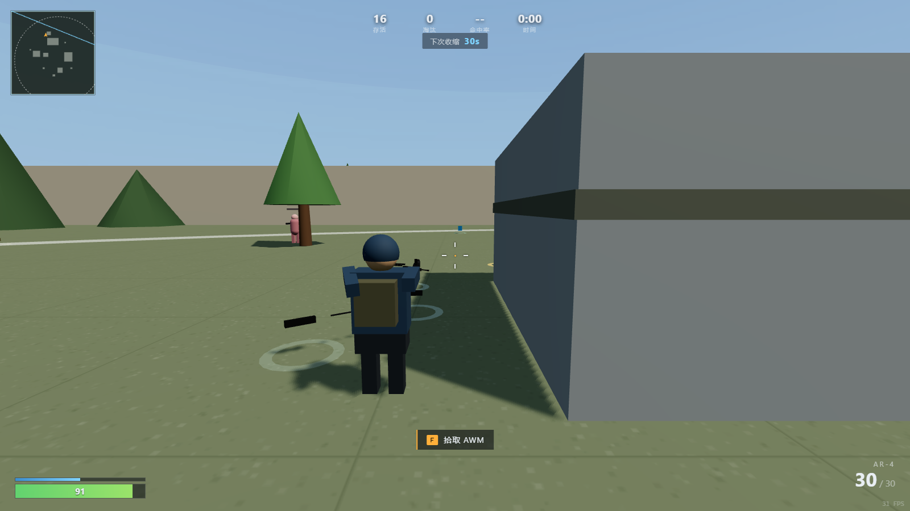

# GAME SANDBOX

一个可以往里塞游戏的网页沙盒。自带两个游戏：**3D 第三人称吃鸡**（DROP ZONE）和一个 2D 小游戏（反应靶场）。
纯前端运行，不联网，可以打包成免安装 exe。



---

## 怎么跑

### 方式一：双击 exe（推荐给玩家）

```
双击 启动游戏.bat
```

或者进 `Sandbox-win32-x64/` 双击 `Sandbox.exe`。

> **整个 `Sandbox-win32-x64` 文件夹是一个整体**，不能只拷 exe，`resources`、`locales`、`*.dll` 都是运行时需要的。发给别人请压缩整个文件夹。

首次启动 Windows 可能弹 SmartScreen 警告（exe 没有代码签名），点「更多信息 → 仍要运行」。

### 方式二：单文件版（只有吃鸡）

双击 `drop-zone.html` 就能玩。three.js、逻辑、样式全在这一个文件里，不需要 Node 和环境。

### 方式三：开发模式

```bash
pnpm install
pnpm dev                 # http://127.0.0.1:5173 ，沙盒首页
```

---

## 目录结构

```
drop-zone/
├─ index.html                  沙盒首页
├─ vite.config.ts              三个页面的入口
├─ electron/main.cjs           桌面壳：本地静态服务 + 窗口
│
├─ src/                        ← 通用层（不含任何具体游戏）
│  ├─ main.ts                  首页入口
│  ├─ style/base.css           共用样式
│  ├─ shell/                   registry 清单 · hub 首页 · types 类型
│  ├─ core/                    input 输入 · collision 碰撞
│  ├─ systems/                 audio 音效 · cameraRig 镜头 · effects 特效 · navgrid 寻路
│  └─ world/terrain.ts         地形工具
│
├─ games/                      ← 游戏层（一个游戏一个包）
│  ├─ battle-royale/
│  │  ├─ index.html            页面（HUD 标记）
│  │  ├─ main.ts               入口
│  │  ├─ game.ts               一局游戏的编排
│  │  ├─ style.css             这个游戏的样式
│  │  ├─ engine/               人机、射击、缩圈、拾取、地图、玩家、跳伞…
│  │  └─ ui/hud.ts             血条、准星、武器图标
│  └─ reaction/                反应靶场（页面 + 入口 + 实现 + 样式）
│
├─ tools/                      构建与调试脚本
├─ Sandbox-win32-x64/          打包好的 exe
└─ drop-zone.html              单文件版
```

## 分层规则

```
沙盒外壳 (shell)  ──列出游戏、负责导航，不碰游戏内部
        ↓
游戏 (games)      ──自带页面/代码/样式，游戏之间互不依赖
        ↓
引擎 (src)        ──只提供通用能力，不依赖任何游戏
```

依赖只能是单向的：`games → src`。`src/` 里出现任何 `import games/` 就说明分层被破坏了。

---

## 加一个新游戏

**1. 建文件夹**

```
games/my-game/
├─ index.html     页面
├─ main.ts        入口（3 行）
└─ game.ts        实现
```

`index.html`：

```html
<!doctype html>
<html lang="zh-CN">
  <head>
    <meta charset="UTF-8" />
    <title>我的游戏</title>
    <style>
      html, body { margin: 0; height: 100%; background: #070a0e; }
    </style>
  </head>
  <body>
    <div id="app"></div>
    <script type="module" src="./main.ts"></script>
  </body>
</html>
```

`main.ts`：

```ts
import { createGame } from './game'

const mount = document.getElementById('app')
if (mount) createGame(mount)
```

`game.ts`：

```ts
export function createGame(mount: HTMLElement): void {
  mount.innerHTML = '<h1 style="color:#fff">我的游戏</h1>'
  // 渲染、循环、输入、清理，全由你自己管
}
```

**2. 登记**

`src/shell/registry.ts` 加一条：

```ts
{
  id: 'my-game',
  name: '我的游戏',
  tagline: '一句话介绍',
  desc: '详细一点的描述',
  tags: ['2D', '休闲'],
  href: './games/my-game/index.html',
}
```

**3. 加页面入口**

`vite.config.ts` 的 `rollupOptions.input` 里加一行：

```ts
myGame: page('./games/my-game/index.html'),
```

**4.** `pnpm dev` 打开首页，卡片就出来了。

想复用引擎能力（3D、碰撞、音效、寻路），直接从 `src/` 里 import 即可，参考吃鸡的写法。

---

## 命令

| 命令 | 作用 |
| --- | --- |
| `pnpm dev` | 开发服务器（沙盒 + 各游戏页面） |
| `pnpm build` | 类型检查 + 打包到 `dist/` |
| `pnpm run build:single` | 生成 `drop-zone.html`（吃鸡单文件版） |
| `pnpm run pack:exe` | 打成 Windows 免安装程序 |
| `pnpm run preview` | 预览构建产物 |

### 打包 exe 的两个坑

1. pnpm 默认拦截 Electron 的安装脚本，装依赖要加参数：
   ```bash
   pnpm add -D electron @electron/packager --allow-build=electron
   ```
2. 如果网络有中间人代理，下载 Electron 二进制会报 `UNABLE_TO_VERIFY_LEAF_SIGNATURE`，打包前设一个环境变量：
   ```bash
   set NODE_TLS_REJECT_UNAUTHORIZED=0
   ```
   （只影响下载，不影响运行）

---

## 两个游戏

### DROP ZONE（3D 吃鸡）

- 两张地图：训练场 164×164（16 人）、孤岛 640×640（64 人）
- 孤岛有山地、一条横贯全图的河（三座桥）、8 个建筑群、车辆残骸
- 全体跳伞入场：飞机 → 自由落体 → 62m 自动开伞
- 四把枪：AR-4 突击步枪、SG-9 霰弹枪、DMR 精准射手、AWM 狙击枪（带倍镜）
- 护甲吸收 60% 伤害，武器/弹药/护甲/头盔都可拾取
- 缩圈 6 个阶段，一局约 5.5 分钟

操作：`WASD` 移动 · `Shift` 冲刺 · `Space` 跳伞/跳跃 · `左键` 射击 · `右键` 瞄准 · `R` 换弹 · `1/2` 换枪 · `F` 拾取 · `M` 静音 · `Esc` 暂停

### 反应靶场

30 秒内点掉随机出现的靶子，连击不断分数越高。用来验证沙盒能同时容纳非 3D 的小游戏。

---

## 已知限制

- **exe 没有代码签名**，Windows 会提示风险
- **资产是程序化几何体**，没有贴图模型；做到写实需要 glTF/PBR 资源管线
- **人机不会跳伞**以外的协同，没有小队、没有载具驾驶（车辆是静态掩体）
- **没有移动端适配**，需要键盘鼠标
- 加游戏需要重新构建（没有运行时插件加载）
